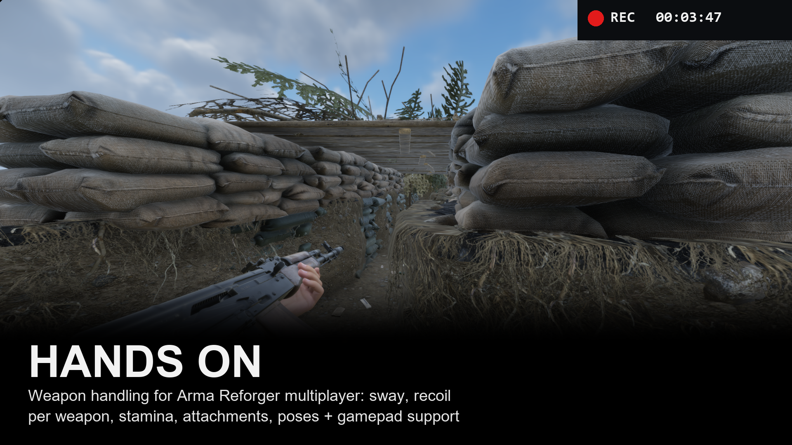
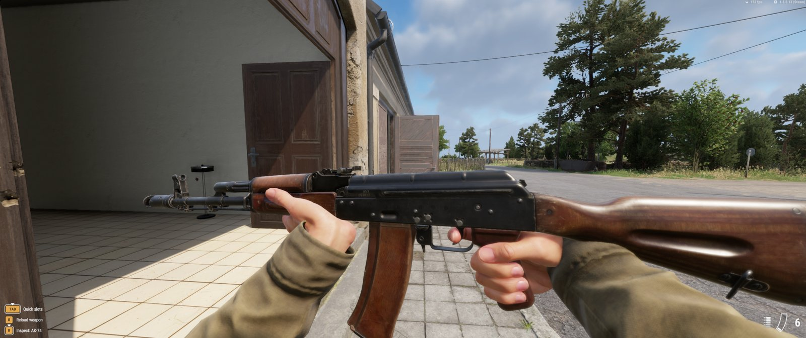
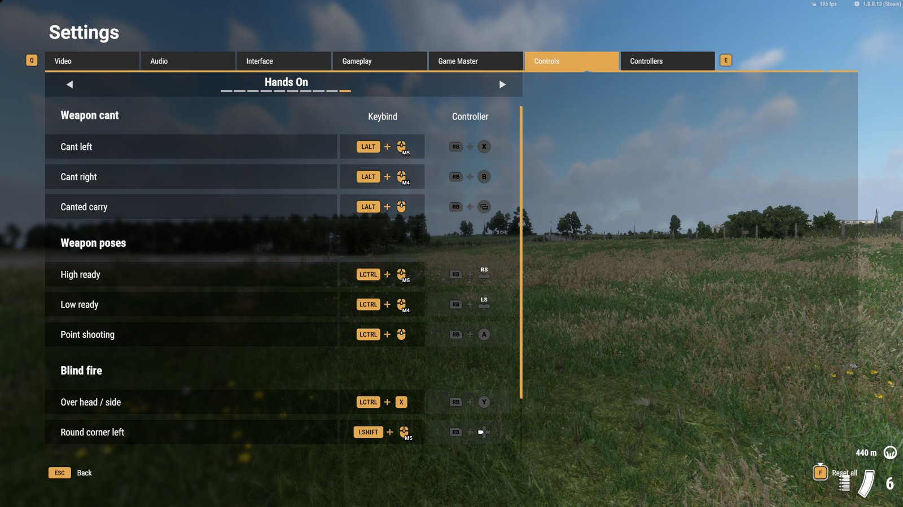
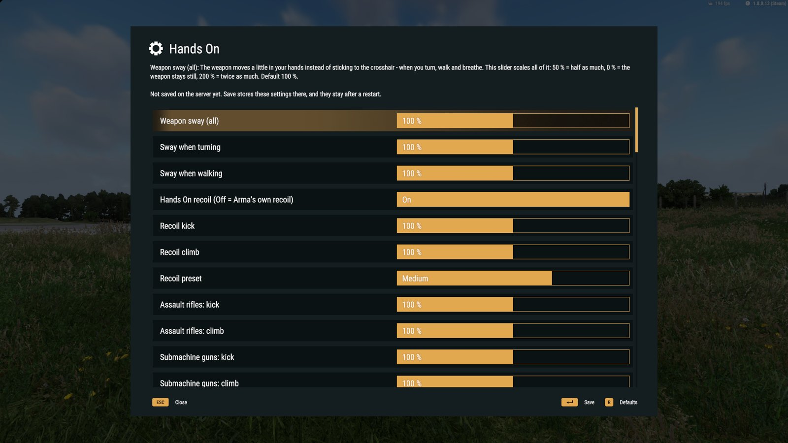

# Hands On

**Weapon handling for Arma Reforger multiplayer** (formerly Bodycam Reforger). Your rifle is carried, not glued to the
mouse: it sways with your movement, kicks with Arma's own recoil, gets heavier the longer you aim and settles when you
rest it. Camera, movement, menus, rocket launchers and vehicles stay Arma's.

**[Get it on the Arma Reforger Workshop](https://reforger.armaplatform.com/workshop/F26C9CD1DDF4D30E)** – in game:
Workshop → search "Hands On" → subscribe. Servers list it like any other mod (mod ID `F26C9CD1DDF4D30E`, the same item
as Bodycam Reforger); players download it automatically. Version **1.9.6** – new: an optional deadzone while
aiming, off by default. All changes: [Workshop change log](https://reforger.armaplatform.com/workshop/F26C9CD1DDF4D30E/changelog).

## Sway – the weapon moves with you

- Turning, walking, strafing and leaning move the weapon in your hands; on fast turns it lags and lowers.
- From the hip the same soft sway as aimed, no invisible wall.
- Stop turning and it swings a little past, then settles exactly where you stopped.
- Crouched and prone it calms down; rested on cover or a bipod it stays almost still.

## Recoil – Arma's own, your server's settings

- Every weapon keeps its own Arma recoil – per weapon, stance and aim, Workshop weapons included.
- On top, admins scale kick and climb – for all weapons and per class (rifles, SMGs, MGs, marksman rifles, pistols,
  shotguns, bolt-action rifles). Medium = Arma's recoil.
- Attachments you mount make the weapon heavier, so it kicks a little less (at most 20 %). The magazine and the parts a
  weapon comes with don't count.

## Arm stamina – aiming makes your arms tired

- Aiming uses up arm stamina: fastest standing, slower crouched, prone, rested on cover, slowest lying on a rested bipod.
  Only a bipod that really rests on something counts.
- Under 60 % the weapon swings with your breath – less crouched, prone or rested. Off the sights your arms recover,
  twice as fast in low or high ready.
- **Hold breath** – `Shift` (controller: hold `A`) while aiming: after 0.6 s the aim stands still, as long as your arms
  allow (6 s fresh, 2.4 s tired) or until you fire.
- A small arm stamina bar bottom left (not your sprint stamina), hidden when full. Admins can turn it off.

## Attachments – pros and cons

- Brakes, compensators and suppressors keep their own recoil effect, at most 20 % less.
- Angled foregrips steady the aim a little; stocks slow arm fatigue.
- A suppressor makes the weapon front-heavy and tires the arms faster; an under-barrel launcher or a bipod makes it
  sway more.

## Poses – every player sees them

| Pose | Keyboard | Controller | |
|---|---|---|---|
| **High ready** | `Ctrl + Mouse 5` | `RB + R3` | muzzle up in front of the chest |
| **Low ready** | `Ctrl + Mouse 4` | `RB + L3` | Arma's own lowered weapon |
| **Blind fire over the head** | `Ctrl + X` | `RB + Y` | lean to fire round the left or right corner |
| **Blind fire round the corner** | `Shift + Mouse 5` | `RB + D-pad left` | across the body round the left corner |
| **Point shooting** | `Ctrl + Middle mouse` | `RB + A` | canted at the hip for quick close shots |
| **Canted carry** | `Alt + Middle mouse` | `RB + View` | tilted low in view, to walk with |
| **Canting** | `Alt + Mouse 5` / `Alt + Mouse 4` | `RB + X` / `RB + B` | tilts the weapon 30° left / right |

Combine them: lean in any pose, cant + lean the same way reaches further out; the cant keys pick the side for point
shooting and the canted carry. Aiming ends any pose. The support hand stays on its grip.

## Controls

Every key has a keyboard and a controller default (`RB` is the modifier). Each player rebinds everything in
**Settings → Controls → "Hands On - Keys"** – no admin rights needed.

**Deadzone** (optional, off by default) – below the keys each player can turn it on. Aimed through iron sights,
red dots and holo sights, small mouse moves then move the weapon in the picture and only a bigger one turns the view:
up to 2° sideways and 0.6° up and down by default, both adjustable. Only your own view changes – the bullets still go
where the sight points, and other players see nothing different. Scopes and the hip are unchanged.

## Server settings – admins only

Pause menu → **Hands On**. Only admins see it (the host, `#login` or the server's admin list).

- Every setting explains what it does and its default. 0 % switches a feature off.
- Recoil preset Light / Medium / Heavy (Medium = Arma's recoil, Light 30 % less, Heavy 30 % more), or kick and climb per
  weapon class. "Hands On recoil" Off = Arma's plain recoil.
- Sway, weapon physics, posture and rest, cant angle, hold-breath time, arm fatigue, hit reaction and more.
- Blind fire can be switched off; every pose can be moved for everyone.
- Saved on the server, kept after a restart, sent to every player – late joiners included.

## Multiplayer

- Hit registration stays Arma's: bullets leave where your barrel points, also in blind fire. Tested on a dedicated
  server with two players: server and client agree on every shot.
- Poses and canting reach every player. The sway runs only on the shooter's PC.

## Compatibility

- Every weapon built on Arma's weapon base classes: tested with 2,534 Workshop weapons, 9 in 10 get its handling. Their
  attachments get the same pros and cons as Arma's.
- Under-barrel launchers get it all; rocket launchers keep Arma's handling, lock-on included.
- Other sway, recoil or pose mods stack with it – not recommended together.

## Deutsch

Waffenhandling für Arma Reforger Multiplayer (früher Bodycam Reforger): Die Waffe schwankt mit deiner Bewegung, schlägt
mit Armas eigenem Rückstoß aus, wird beim langen Zielen schwer (Arm-Ausdauer, Atem anhalten mit `Shift`) und kommt
aufgelegt oder auf dem Zweibein zur Ruhe. Anbauteile haben Vor- und Nachteile. Posen, für alle Spieler sichtbar: High
Ready, Low Ready, Blind Fire über den Kopf und um die Ecke, Point Shooting, schräge Trageweise und Kanten – kombinierbar
mit Lehnen. Jede Taste hat eine Tastatur- und Controller-Belegung; jeder Spieler belegt sie selbst um unter Einstellungen
→ Steuerung → „Hands On - Keys“; dort schaltet jeder Spieler auch die optionale Deadzone ein (standardmäßig aus:
kleine Mausbewegungen bewegen beim Zielen erst die Waffe im Bild, dann das Bild). Admins stellen im Pausemenü unter „Hands On“ alles für alle Spieler ein (Rückstoß-Preset
Leicht / Mittel / Schwer, Mittel = Armas Rückstoß). Die Trefferabfrage bleibt Armas – die Kugeln gehen genau dahin, wo
dein Lauf zeigt, auch auf dem Server. Mod im Spiel unter **Workshop → „Hands On“**.

## License

© 2026 VAST-ON-GIT-OPENSOURCE. The mod "Hands On" (formerly "Bodycam Reforger"), this page, its texts and images:
**all rights reserved** – no reuploads, edits or redistribution.

Not affiliated with Reissad Studio (BODYCAM) or Bohemia Interactive (Arma Reforger). Contains no BODYCAM files or content.
