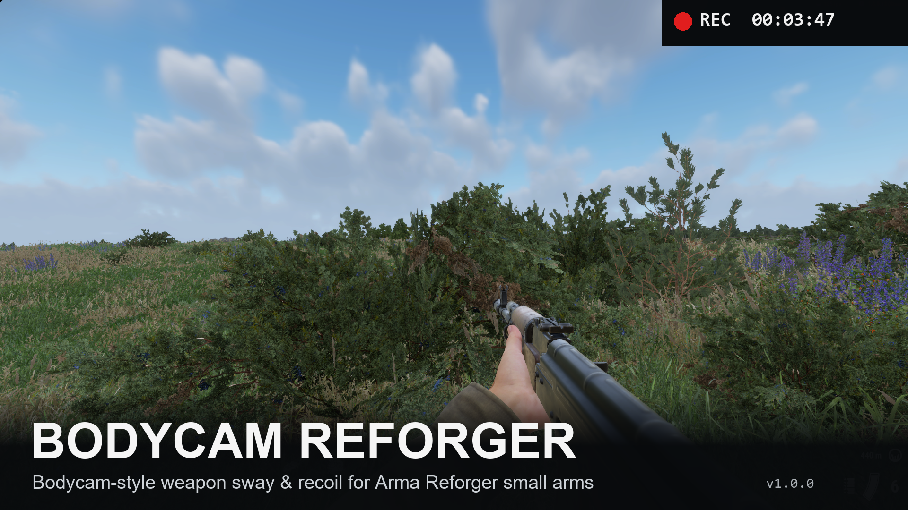
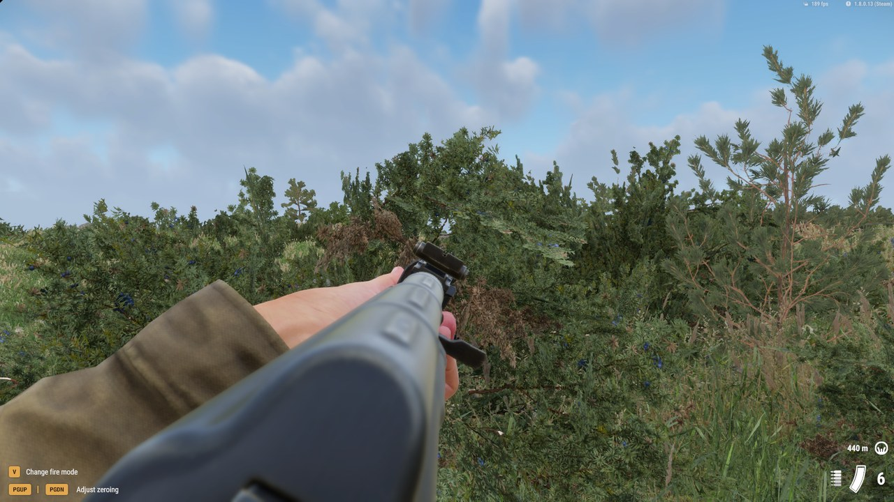
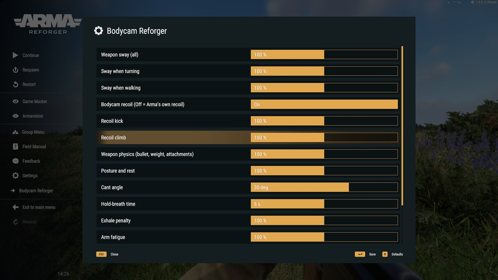

# Bodycam Reforger

**Bodycam-style weapon handling for Arma Reforger multiplayer.** Your weapon is carried, not glued to the mouse: every
small arm sways, kicks and settles like a real weapon in real hands. Camera, movement, controls, menus and all vehicles
stay Arma's.

**[Get it on the Arma Reforger Workshop](https://reforger.armaplatform.com/workshop/F26C9CD1DDF4D30E-BodycamReforger)**
– in game: Workshop → search "Bodycam Reforger" → subscribe. Servers list it like any other mod (mod ID
`F26C9CD1DDF4D30E`); players download it automatically. Version **1.4.0**.

## Weapon handling

- **Sway** – turning, walking, strafing and leaning move the weapon in your hands; it lowers on fast turns. Separate
  behaviour from the hip and aimed.
- **Recoil per weapon class** – rifles, machine guns, DMRs, pistols, SMGs, shotguns and bolt-action rifles – with a spray
  pattern: each shot moves your real aim, and it settles back after the burst. Launchers keep Arma's recoil.
- **Weapon physics** – the kick follows the bullet and the weapon's total weight with every attachment and the magazine:
  a scope, launcher or suppressor makes it steadier, also on Workshop weapons. Suppressors, muzzle brakes, compensators
  and foregrips take some of the kick.
- **Posture** – crouched or prone the weapon sways and kicks less; rested on cover or on the bipod it stays almost still,
  so scoped bursts stay on target.
- Iron sights and red dots stay usable; magnified optics keep Arma's view. A small camera kick per shot.

## Poses – every player sees them

| Pose | Key | |
|---|---|---|
| **High ready** | `Ctrl + Mouse 5` | muzzle up in front of the chest; the trigger brings the weapon down first |
| **Low ready** | `Ctrl + Mouse 4` | Arma's own lowered weapon, also while sprinting |
| **Blind fire** | `Ctrl + X` | weapon over the head; with `Q` / `E` round the left / right corner |
| **Point shooting** | `Ctrl + Middle mouse` | canted at the hip for quick close shots |

The same key ends a pose; aiming down the sights ends any pose. Admins can switch blind fire off for the whole server.

## Body

- **Canting** – `Alt + Mouse 5` / `Alt + Mouse 4` tilts the weapon 30° to the left / right (the same key again levels it).
  Weapon and view move out to that side; canted and leaning the same way you reach 9 cm further round the corner, from
  the hip and aimed. Every player sees your cant.
- **Hold breath** – hold `Shift` while aiming: steadier for about 6 seconds (shorter when out of breath), then a short,
  shaky exhale.
- **Arm fatigue** – long aiming makes the weapon unsteady and it sinks; much later when crouched, prone or rested.
- **Tremor and hits** – out of breath or with a wounded arm your hands tremble; a hit knocks the weapon away; raised to
  the eye, the weapon settles into the shoulder.
- All keys: Settings → Controls → "Bodycam Reforger".

## Server settings for admins

Pause menu → **Bodycam Reforger** (right under Settings):

| Setting | Range |
|---|---|
| Weapon sway (all), when turning, when walking | 0–200 % |
| **Bodycam recoil** – Off = Arma's complete original recoil (sway and the rest stay) | On / Off |
| Recoil kick, recoil climb, weapon physics, posture and rest | 0–200 % |
| Cant angle | 0–45° |
| **Blind fire allowed** – Off = no blind fire on the server | On / Off |
| Hold-breath time, exhale, arm fatigue, tremor, hit reaction, settling | 0–200 % |

0 % switches a feature off. Only the host and logged-in server admins (`#login`) can change the values – not a voted-in
session admin. The server keeps
them in its profile folder (`bcr/settings.txt`, also editable there) and sends them to every player – also to players who
join later. Everyone else sees them read-only.

## Multiplayer

- Hit registration stays Arma's: bullets leave exactly where your barrel points, on the server too. Tested on a dedicated
  server with two players: every shot of a burst leaves the same way on the server as on the shooter's PC – with our
  recoil, with Arma's and in blind fire.
- Poses and canting go to every player, also to players joining later. The sway runs only on the shooter's PC; the
  server keeps the settings and the pose of each soldier.

## Compatibility

- Works for weapons built on Arma's weapon base classes, including many Workshop weapons and their attachments. Weapon
  packs with their own base classes keep their own handling.
- Other weapon sway, recoil or pose mods stack with this one – not recommended together.
- Vehicles, turrets and mounted weapons are not touched.

## Deutsch

Waffenhandling im Bodycam-Stil für Arma Reforger Multiplayer: Schwanken, Rückstoß pro Waffenklasse (abhängig von Geschoss
und Gesamtgewicht mit allen Anbauteilen; Schalldämpfer, Mündungsbremse, Kompensator und Griff nehmen Rückstoß), Haltung,
aufgelegt und Zweibein fast ruhig. Neu in 1.4, für alle Spieler sichtbar: High Ready (`Strg + Maus 5`), Low Ready
(`Strg + Maus 4`), Blind Fire (`Strg + X`, mit `Q` / `E` um die Ecke), Point Shooting (`Strg + mittlere Maustaste`).
Kanten (`Alt + Maus 5 / 4`, mit Lehnen zur selben Seite 9 cm weiter um die Ecke), Atem anhalten (`Shift`), Arm-Ermüdung,
Zittern und Treffer-Reaktion. Admins stellen im Pausemenü unter „Bodycam Reforger“ jede Wirkung für alle Spieler ein;
„Bodycam recoil“ schaltet auf Armas originalen Rückstoß zurück, „Blind fire allowed“ schaltet Blind Fire ab. Die
Trefferabfrage bleibt Armas – die Kugeln gehen genau dahin, wo dein Lauf zeigt, auch auf dem Server und im Blind Fire.
Mod im Spiel unter **Workshop → „Bodycam Reforger“**.

## License

© 2026 VAST-ON-GIT-OPENSOURCE. The mod "Bodycam Reforger", this page, its texts and images: **all rights reserved** –
no reuploads, edits or redistribution.

Not affiliated with Reissad Studio (BODYCAM) or Bohemia Interactive (Arma Reforger). Contains no BODYCAM files or content.
